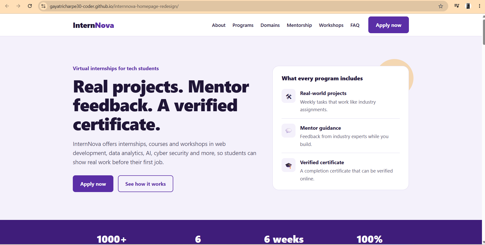
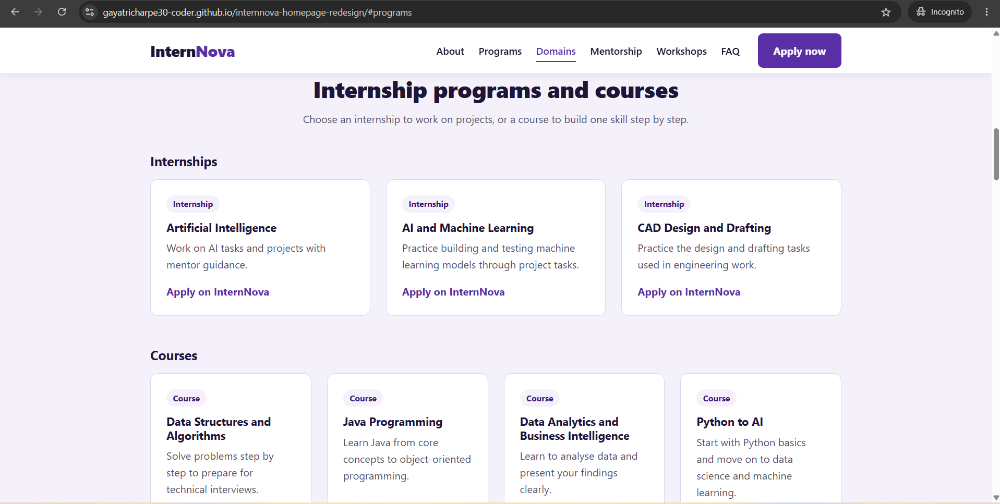
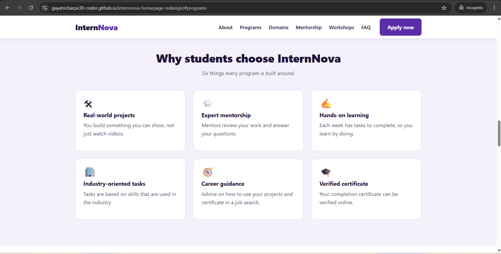
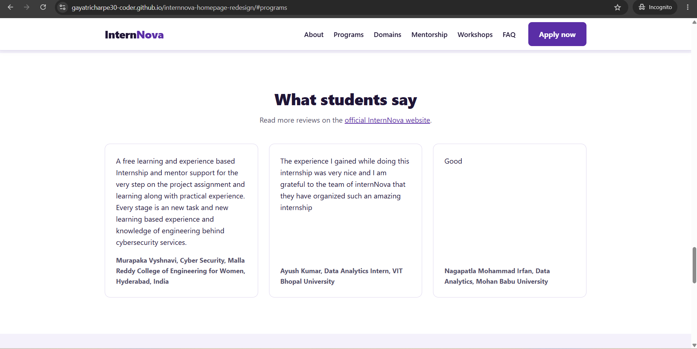
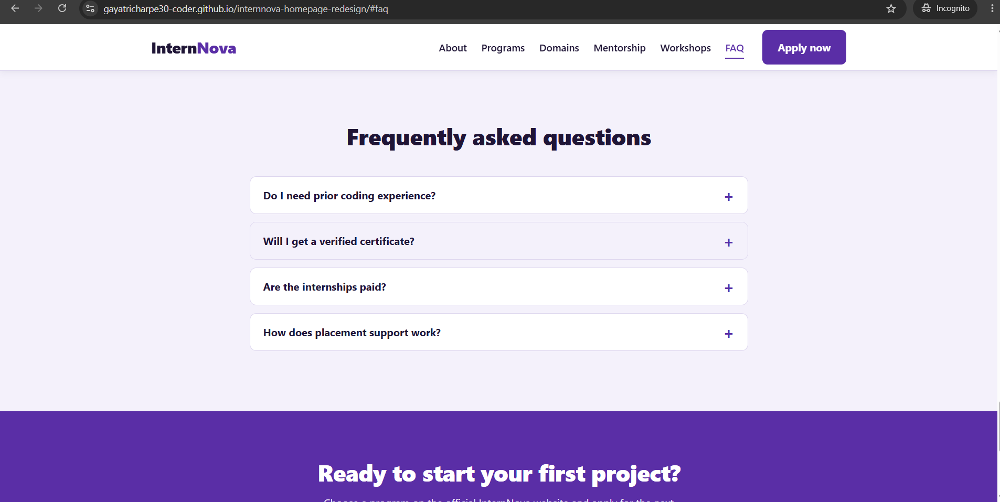
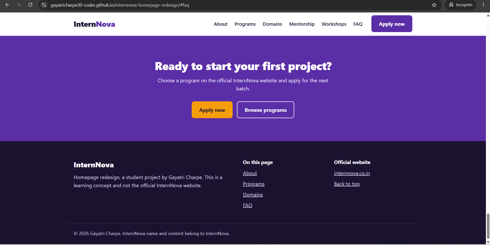
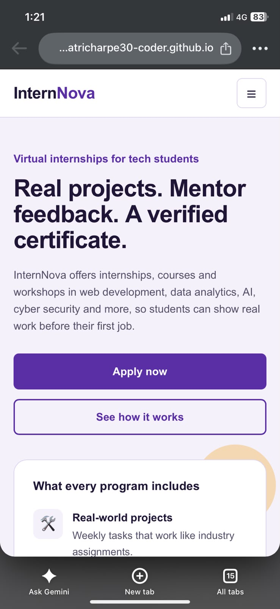
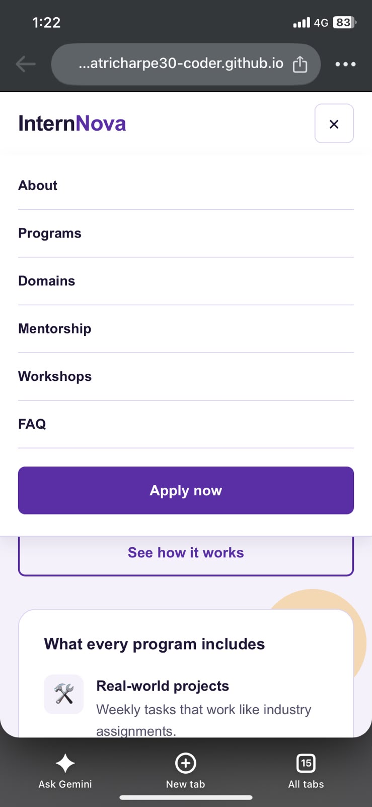

# InternNova Homepage Redesign

## Project Overview
A redesigned homepage concept for InternNova, a virtual internship and learning platform for tech students.
This is a student project and not the official InternNova website.

## Objective
Analyse the existing InternNova homepage and create an original, responsive homepage with a clearer layout.

## Features
- Sticky navigation bar with a mobile menu
- Hero section with one main action
- Statistics, About, Programs, Domains, Why Choose, Mentorship, Workshops, Reviews, FAQ, Call-to-action and Footer
- FAQ accordion
- Smooth scrolling and active menu link
- Simple scroll reveal animation
- Responsive layout for desktop, tablet and mobile

## Technologies Used
- HTML5 (semantic tags)
- CSS3 (variables, flexbox, grid, media queries)
- Vanilla JavaScript

## Website Sections
Navigation, Hero, Statistics, About, Internship Programs, Internship Domains, Why Choose InternNova, Learning and Mentorship, Workshops, Reviews, FAQ, Call-to-Action, Footer.

## Responsive Design
- Desktop: full navigation, 3 and 4 column cards
- Tablet: 2 column cards
- Mobile: hamburger menu, single column cards, full width buttons

internnova-homepage-redesign/
├── index.html
├── css/
│   └── style.css
├── js/
│   └── script.js
├── internnova-screenshots/
└── README.md

## How to Run
1. Download or clone this repository.
2. Open the folder in VS Code.
3. Open `index.html` in a browser (or use the Live Server extension).

## Live Website
https://gayatricharpe30-coder.github.io/internnova-homepage-redesign/

## GitHub Repository
https://github.com/gayatricharpe30-coder/internnova-homepage-redesign

## Screenshots

### Desktop

### Mobile

## Author
Gayatri Charpe, MCA Student
